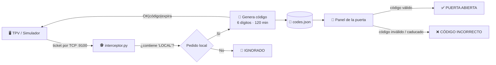

<div align="center">

# 🚪 codeDoor

**Control de acceso por código para el baño de tu local, generado automáticamente desde el ticket de compra.**

Solo los clientes que consumen en el local reciben un código. Sin llaves, sin fichas, sin preguntar al camarero.

[](https://www.python.org/)
[](https://docs.python.org/3/library/tkinter.html)
[](#-requisitos)
[](#-cómo-funciona)

</div>

---

## ✨ ¿Qué es codeDoor?

En muchos bares, cafeterías y restaurantes el baño es **solo para clientes**. El problema de siempre: llaves que se pierden, códigos fijos que acaba sabiendo todo el barrio o personal interrumpido cada dos minutos.

**codeDoor** lo resuelve colocándose entre el TPV y la impresora de tickets:

1. 🧾 El TPV manda el ticket a imprimir.
2. 🕵️ codeDoor lo **intercepta** y comprueba si es un pedido para tomar **en el local**.
3. 🔢 Si lo es, genera un **código temporal de 6 dígitos** (válido durante 2 horas).
4. 🚪 El cliente introduce el código en el panel de la puerta y… **¡acceso concedido!**

Los pedidos para llevar o a domicilio se ignoran: no generan código.

---

## 🧠 Cómo funciona



El interceptor escucha en el **puerto 9100**, el puerto estándar de impresión RAW (JetDirect) que usan la mayoría de impresoras de tickets, así que encaja de forma natural en el flujo de un TPV real.

### 📡 Protocolo

| Petición | Respuesta |
|---|---|
| Ticket que contiene la palabra `LOCAL` | `OK\|<código>\|<timestamp_expiración>` |
| Cualquier otro ticket | `IGNORADO` |

La detección no distingue mayúsculas/minúsculas y busca la palabra completa (`\bLOCAL\b`), así que `Pedido local #12` cuenta, pero `LOCALIZACIÓN` no.

---

## 🖼️ Panel de control (GUI)

`panel_gui.py` es una aplicación de escritorio que reúne todo en una sola ventana, ideal para hacer demos:

- **📝 Editor de ticket** — escribe el contenido del ticket y envíalo al interceptor.
- **🖥️ Consola de proceso** — muestra paso a paso, con colores, lo que ocurre:
  ```
  1. Enviando ticket al interceptor...
  2. Buscando la palabra LOCAL...
     Pedido local detectado
  3. Código generado: 483993
  4. Válido hasta las 15:42
  ```
- **🔢 Teclado de la puerta** — introduce el código y pulsa *Enter* o *Comprobar*.
- **🚦 Indicador de estado de la puerta**:

| Estado | Color | Cuándo |
|---|---|---|
| `PUERTA CERRADA` | 🔴 Rojo | En reposo o tras un código incorrecto |
| `INTRODUCIENDO CÓDIGO` | 🟡 Amarillo | Mientras se teclea |
| `PUERTA ABIERTA (5…1)` | 🟢 Verde | Código válido, cuenta atrás de 5 s y se vuelve a cerrar |

---

## 📁 Estructura del proyecto

```
codeDoor/
├── interceptor.py       # 🕵️ Servidor TCP: recibe tickets y genera códigos
├── panel_gui.py         # 🖼️ Panel gráfico: envío de tickets + puerta con teclado
├── panel_puerta.py      # ⌨️ Panel de la puerta en modo terminal
├── simulador_pedido.py  # 🧾 Envía un ticket de prueba ("PEDIDO LOCAL #123")
└── codes.json           # 📄 Almacén de códigos y su fecha de caducidad
```

---

## 🚀 Puesta en marcha

### 📋 Requisitos

- **Python 3.8+**
- **Tkinter** (solo para la GUI). Normalmente viene con Python; si no:
  ```bash
  # Debian / Ubuntu
  sudo apt install python3-tk
  # Fedora
  sudo dnf install python3-tkinter
  ```

No hace falta instalar nada con `pip`: todo usa la librería estándar. 🎉

### ▶️ Ejecución

Clona el repositorio:

```bash
git clone https://github.com/JoseMasiaTormo/codeDoor.git
cd codeDoor
```

**1. Arranca el interceptor** (déjalo corriendo en una terminal):

```bash
python3 interceptor.py
# Escuchando en el puerto 9100...
```

**2. Elige cómo quieres probarlo:**

<details open>
<summary><b>🖼️ Opción A — Panel gráfico (recomendado)</b></summary>

```bash
python3 panel_gui.py
```

Escribe un ticket como `PEDIDO LOCAL #42`, pulsa **Enviar ticket**, copia el código que aparece en la consola e introdúcelo en el teclado de la puerta.

</details>

<details>
<summary><b>⌨️ Opción B — Todo por terminal</b></summary>

En otra terminal, simula un pedido:

```bash
python3 simulador_pedido.py
```

El interceptor mostrará el código generado. Después abre el panel de la puerta:

```bash
python3 panel_puerta.py
# ==== PANEL DE ACCESO AL BAÑO ====
# Introduce código (o 'salir'): 483993
# >>> ACCESO CONCEDIDO.
```

</details>

> [!IMPORTANT]
> Ejecuta todos los scripts **desde la carpeta del proyecto**: comparten el fichero `codes.json` mediante una ruta relativa.

---

## ⚙️ Configuración

Los parámetros principales están como constantes al inicio de cada script:

| Constante | Fichero | Por defecto | Descripción |
|---|---|---|---|
| `EXPIRY_MINUTES` | `interceptor.py` | `120` | Minutos de validez de cada código |
| `PATTERN` | `interceptor.py` | `\bLOCAL\b` | Expresión regular que identifica un pedido en local |
| Puerto | `interceptor.py` | `9100` | Puerto TCP en el que se escuchan los tickets |
| `SEGUNDOS_ABIERTA` | `panel_gui.py` | `5` | Segundos que la puerta permanece abierta |

---

## 🗺️ Ideas de futuro

- [ ] 🖨️ Reenviar el ticket a la impresora real con el código impreso al pie
- [ ] 🧹 Limpieza automática de códigos caducados en `codes.json`
- [ ] 🔐 Invalidar el código tras su primer uso (opcional)
- [ ] 🔌 Integración con una cerradura real (Raspberry Pi + relé)
- [ ] 📊 Estadísticas de uso por franja horaria

---

<div align="center">

Hecho con ☕ y 🐍 por [**JoseMasiaTormo**](https://github.com/JoseMasiaTormo)

⭐ Si te ha gustado la idea, ¡deja una estrella!

</div>
